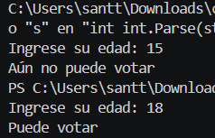

# Problema 01. Registro electoral
**Estructura elegida:** `if-else`
**Justificación:** Se plantea una decisión sencilla de dos caminos mutuamente excluyentes basada en una condición simple (mayor o igual a 16).
**Evidencia:**
