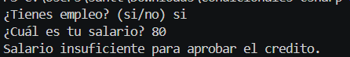

# Problema 12

## Enunciado
Aprovavion del credito

## Estructura condicional elegida
else if

## Justificación
Se utilizo una estreuctura de else if o para poder validar varios campos, como que  si tuviera empleo y que el salario si cumpliera con los parametros

## Evidencia

