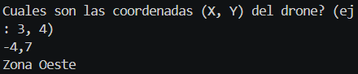

# Problema 16

## Enunciado
ubicacion de un dron

## Estructura condicional elegida
switch

## Justificación
Se utilizo un switch para no tener que validar con varios if y else if si no solo validarlo de una sola vez

## Evidencia

