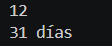

# Problema 20

## Enunciado
Dias de cada mes

## Estructura condicional elegida
switch expression con agrupaciones (or)

## Justificación
Mapeo de múltiples valores a un mismo resultado.

## Evidencia

