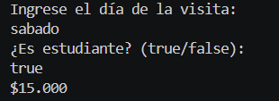

# Problema 27

## Enunciado
Tiquete de cine

## Estructura condicional elegida
Operadores ternarios encadenados.

## Justificación
Evaluación en cascada de múltiples variables booleanas/texto.

## Evidencia

