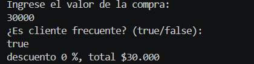

# Problema 28

## Enunciado
Descuento por compra

## Estructura condicional elegida
Ternario anidado + if simple.

## Justificación
Regla base jerárquica con un modificador condicional extra.

## Evidencia

