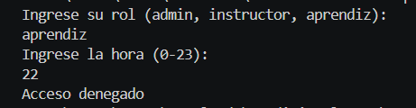

# Problema 29

## Enunciado
Control de acceso a la sede

## Estructura condicional elegida
switch expression con tuplas.

## Justificación
Múltiples variables determinan un solo resultado lógico (matriz de decisiones).

## Evidencia

