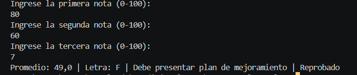

# Problema 30

## Enunciado
boletin de calificaciones

## Estructura condicional elegida
Múltiples switch expressions.

## Justificación
Proceso de transformación en cadena (Notas -> Promedio -> Letra -> Mensaje).

## Evidencia

